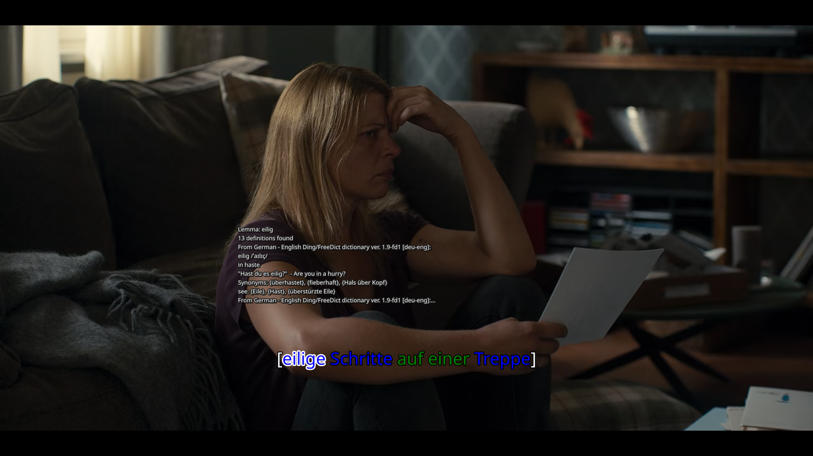

# mpv AnkiMorphs subtitle highlighter

A Lua mpv script plus a persistent Python backend. It uses the selected subtitle track, pre-analyzes subtitle cues in the background with the selected spaCy model, reads morph learning intervals from the AnkiMorphs SQLite database, and draws the result as an ASS OSD overlay.

Analyzed cue results are cached in a private SQLite database on tmpfs: `/tmp/mpv-ankimorphs-<UID>/highlights.sqlite3`. This cache survives mpv restarts but is volatile: it disappears when `/tmp` is cleared or the machine reboots. It never writes cache data into the Anki profile. The default directory is mode `0700`; the cache is bounded to 30,000 cues.



## Install

```sh
./install.sh
```

The installer creates two proper mpv directory scripts. It updates plugin code
on reinstall, but **never overwrites existing files** in `script-opts/`; when a
config already exists, merge any new options yourself:

```text
~/.config/mpv/
├── scripts/
│   ├── ankimorphs/
│   │   ├── main.lua
│   │   └── backend.py
│   └── ankimorphs-dict/
│       └── main.lua
└── script-opts/
    ├── ankimorphs.conf
    └── ankimorphs-dict.conf
```

This directory-script layout matters: mpv treats each immediate subdirectory
of `scripts/` as a script and expects a `main.lua` (or another supported
`main.*`) entry point. The installer also removes the old loose
`scripts/ankimorphs.lua` entry point to prevent duplicate loading.

Then check:

```text
~/.config/mpv/script-opts/ankimorphs.conf
```

The defaults match the paths supplied in the request:

- Profile: `~/.local/share/Anki2/User 1`
- spaCy environment: `~/.local/share/Anki2/addons21/spacy-venv-python-3_14`
- Database: `~/.local/share/Anki2/User 1/ankimorphs.db`
- Priority files: `~/.local/share/Anki2/User 1/priority-files`

The backend executes the environment's `bin/python`. That interpreter must be able to import spaCy and the model packages installed in that environment. If the virtualenv uses a different executable path, set `python=` explicitly in `ankimorphs.conf`.

## Controls

| Key | Action |
|---|---|
| `toggle_highlighting_key` (default `ctrl+alt+h`) | Toggle AnkiMorphs highlighting |
| `ctrl+alt+s` | Switch primary / secondary subtitle track |
| `ctrl+alt+m` | Choose an installed spaCy model |
| `ctrl+alt+p` | Choose a CSV priority file (or none) |

The main highlighter's toggle key is configurable in
`~/.config/mpv/script-opts/ankimorphs.conf`:

```conf
toggle_highlighting_key=ctrl+alt+h
```

Change the value to any mpv key name (for example `F8` or `ctrl+h`). Set it to
an empty value to remove the physical shortcut while keeping the script binding
available. This option controls **AnkiMorphs subtitle highlighting itself**;
it is separate from the dictionary companion's `toggle_extension_key`.

The script uses mpv's canonical lowercase modifier syntax and logs the actual
toggle key at startup. If you prefer to define the key yourself in
`input.conf`, append these lines to `~/.config/mpv/input.conf`:

```conf
# The configured default is ctrl+alt+h; replace it with your preferred key.
ctrl+alt+h script-binding ankimorphs/ankimorphs-toggle
ctrl+alt+s script-binding ankimorphs/ankimorphs-source
ctrl+alt+m script-binding ankimorphs/ankimorphs-model-select
ctrl+alt+p script-binding ankimorphs/ankimorphs-priority-select
```

If mpv still reports an unbound key, check that `~/.config/mpv/scripts/ankimorphs/main.lua`
was loaded and inspect mpv's startup log for Lua script errors.

The selected track's normal mpv subtitle display is hidden only while the OSD replacement is active. Its prior visibility setting is restored when the cue ends, highlighting is disabled, the track is switched, or the file ends.

The main script observes mpv's `osd-dimensions` property. Window resizes and fullscreen transitions trigger a short debounced redraw of the current cue using its already analyzed segments, so no new spaCy request is needed. The current cue metadata is republished with the new OSD dimensions but retains the same cue generation; the dictionary companion therefore recalculates hover hitboxes and keeps the keyboard-selected morph and any open dictionary tooltip instead of resetting them.


## Dictionary and word actions

A companion mpv directory script, `ankimorphs-dict`, reads the highlighted cue
published by the main script. It does not start another spaCy process or query
AnkiMorphs independently. Install both scripts with `./install.sh`.

The companion uses the `dict` command-line client and dictd protocol database
`deu-eng` by default. Install the dict client and configure a local dictd server
(or configure the usual `~/.dictrc` remote server settings). The script option
file is:

```text
~/.config/mpv/script-opts/ankimorphs-dict.conf
```

The companion has its own enable/disable toggle, independent of the main
AnkiMorphs highlighter. Its default key is `ctrl+alt+e`:

```conf
toggle_extension_key=ctrl+alt+e
```

Press it to hide/show dictionary tooltips, hover interaction, keyboard word
selection, dictionary lookups, and configured actions. Disabling the companion
does **not** disable subtitle highlighting. Set `toggle_extension_key=` to
disable the toggle shortcut, or send the `toggle-extension` script message to
switch it programmatically.

When the mouse rests on a colored morph, the script performs a dictionary
lookup after `hover_delay` and displays the result in a small OSD tooltip. It
tries the surface form first, then the spaCy lemma if the surface form has no
entry. Results are cached in memory for the current mpv process.

The companion is also usable without a mouse. It navigates through the currently
highlighted morphs in reading order and asks the main AnkiMorphs script to
recolor the selected segment in-place. The main highlighter remains the sole
renderer of subtitle text: the dictionary companion does not draw a duplicate
word or a second subtitle overlay. Dictionary lookups and configured actions
use that selected morph:

| Default key | Action |
|---|---|
| `ctrl+alt+e` | Enable/disable the dictionary companion |
| `ctrl+alt+LEFT` | Select the previous highlighted morph |
| `ctrl+alt+RIGHT` | Select the next highlighted morph |
| `ctrl+alt+u` | Select the next **unknown** morph, skipping known and learning morphs |
| `ctrl+alt+shift+u` | Select the previous **unknown** morph |
| `ctrl+alt+d` | Look up the surface form, falling back to its lemma if needed |
| `ctrl+alt+l` | Look up only the selected morph's spaCy lemma in dictd |
| `ctrl+alt+ENTER` | Run the configured left-click script for the selected morph |
| `ctrl+alt+shift+ENTER` | Run the configured right-click script for the selected morph |

Navigation is limited to AnkiMorphs-colored spans, not every ordinary word in
the subtitle. The first press of next selects the first eligible morph; the
first press of previous selects the last eligible morph. Navigation does not
wrap immediately: stepping past the last item (or before the first item)
clears the selection. Pressing the same navigation key again starts at the
opposite end. This behavior applies independently to general morph navigation
and unknown-only navigation. If there are no unknown morphs, unknown-only
navigation leaves the current selection unchanged.

By default, unknown-only navigation skips both known and learning (fresh)
morphs. Set `include_learning_in_unknown_navigation=yes` to include learning
morphs in both next-unknown and previous-unknown navigation. This same filter
is used by optional automatic selection when a new subtitle cue appears.

To automatically select the first eligible unknown morph whenever a new cue is
shown, enable:

```conf
auto_select_first_unknown_on_new_cue=yes
```

It defaults to `no`. It only runs for a genuinely new cue, not for resize or
other geometry-only updates, and it does not trigger another spaCy analysis.
If no eligible unknown (or included learning) morph exists, nothing is selected.
When enabled, the selection follows the same auto-dictionary behavior as
unknown-only navigation if `auto_dictionary_on_unknown_navigation=yes`.

Dictionary lookup can optionally open automatically after navigation. The two
navigation modes have independent switches, and both default to `no`:

```conf
auto_dictionary_on_morph_navigation=no
auto_dictionary_on_unknown_navigation=no
```

Set either to `yes` to automatically display the dictd result whenever that
navigation type selects a morph. By default, selection adds a white outline
while preserving the morph's original AnkiMorphs status color. Set `selection_color` to an ASS BGR color to
override that foreground; leave it empty (or omit it) to keep the original
status color. Its style is configurable in `ankimorphs-dict.conf`:

```conf
# Empty = preserve original AnkiMorphs foreground.
selection_color=
selection_outline_color=&HFFFFFF&
selection_outline=3
```

For example, `selection_color=&HFF0000&` forces the selected morph to use the
same blue as the AnkiMorphs unknown status. The main highlighter applies the
style override only when the cue-generation and segment index match, and
restores the original AnkiMorphs status color when
the selection moves, clears, or the cue changes. The selection resets when the
subtitle cue changes. Mouse hover/click behavior remains available; clicking
runs the script for the word
under the pointer, while keyboard activation runs it for the selected word.
All keys can be changed in `ankimorphs-dict.conf` using
`toggle_extension_key`, `select_previous_key`, `select_next_key`,
`select_next_unknown_key`, `show_dictionary_key`, `show_lemma_dictionary_key`, `activate_left_key`, and `activate_right_key`.
For example, change `show_lemma_dictionary_key=ctrl+alt+l` to another mpv key
name, or set it empty to disable that shortcut. The default `select_next_unknown_key=ctrl+alt+u` and
`select_previous_unknown_key=ctrl+alt+shift+u` skip known and learning morphs
and navigate only segments whose AnkiMorphs status is `unknown`. Both use the
same clear-at-boundary behavior as general navigation. The
`select-next-unknown` and `select-previous-unknown` script messages expose both
actions to `input.conf` bindings. The `show-lemma-dictionary` script message
provides the lemma lookup action there as well.

Click and keyboard actions are configured in that same file. For example:

```conf
left_click_script=notify-send "Word: $word" "Lemma: $lemma" "Sentence: $phrase"
right_click_script=anki-capture-word "$word" "$phrase"
action_1_key=ctrl+alt+w
action_1_script=notify-send "Word: $word" "Lemma: $lemma" "Sentence: $phrase"
action_2_key=ctrl+alt+a
action_2_script=anki-add-note "$word" "$lemma" "$phrase"
```

Each configured action is executed through `/bin/sh`. The snippet can use three
named shell variables: `$word` is the clicked surface form, `$lemma` is its spaCy
lemma, and `$phrase` is the full sentence containing it. The values are assigned
from subprocess arguments, never interpolated into shell source, and are also
exported for child processes. For backwards compatibility, positional aliases remain available as `$1`
(word), `$2` (phrase), and `$3` (lemma), but new action scripts should use the
named variables. The scripts in
this configuration are arbitrary commands with the full permissions of the
user running mpv; only put trusted commands there. Use POSIX shell syntax.
Six optional keyboard action slots are provided. An action requires a
highlighted morph only when its command references `$word` or `$lemma` (or the
legacy positional aliases `$1` or `$3`). A phrase-only action using `$phrase`
(or `$2`) can run without any word selected. If a selected or hovered morph is
available, `$phrase` is the sentence containing it; otherwise it is the full
current subtitle cue. The word and lemma variables are empty when no morph is
selected. When a keyboard selection is active, keyboard action keys use it;
otherwise they use the hovered morph when one is available.

The default mouse bindings are `MBTN_LEFT` and `MBTN_RIGHT`. mpv key bindings
from the central `input.conf` take precedence over script-added bindings. In
that case, route the mouse buttons explicitly with:

```conf
MBTN_LEFT script-binding ankimorphs-dict/run-left
MBTN_RIGHT script-binding ankimorphs-dict/run-right
```

You can also map keyboard actions through `script-binding
ankimorphs-dict/run-action-1` through `run-action-6`.

Mouse hit-testing estimates Noto Sans glyph advances because mpv's Lua API
does not expose libass text extents. It deliberately disables hit-testing for
subtitle lines wider than the OSD rather than selecting the wrong word. If the
clickable region is consistently too wide or narrow, adjust `hit_width_scale`
in `ankimorphs-dict.conf`.

### AnkiConnect: open the Browser for a highlighted morph and subtitle phrase

The companion includes `ankimorphs-dict/anki_browse.py`. It uses AnkiConnect's
`guiBrowse` action to open Anki's Browser with a combined search:

```text
deck:"deutsch" "am-study-morphs:Was" "Was ist das?"
```

The three conditions are ANDed: the card is in the selected deck, AnkiMorphs
recognizes the clicked word as an unknown morph, and the note contains the exact
subtitle phrase. AnkiMorphs documents the `"am-study-morphs:<word>"` search as
its built-in way to find cards previously studied that contain the highlighted
morph as unknown. `guiBrowse` is AnkiConnect's API action for opening the Browser
with a search query. See the [AnkiMorphs guide](https://mortii.github.io/anki-morphs/user_guide/usage/reviewing-cards.html),
[AnkiConnect API](https://github.com/ankiultimate/anki-connect#graphical-actions),
and [Anki search syntax](https://docs.ankiweb.net/searching.html).

After installing, append the following to
`~/.config/mpv/script-opts/ankimorphs-dict.conf`:

```conf
action_1_key=ctrl+alt+b
action_1_script=python3 "$HOME/.config/mpv/scripts/ankimorphs-dict/anki_browse.py" "$word" "$phrase"
```

The script receives the clicked surface morph and containing subtitle sentence
through the named `$word` and `$phrase` shell variables. The companion also makes
`$lemma` available to other actions. It JSON-encodes the request safely; subtitle
text is never put into shell source or raw JSON.

The default deck is `deutsch`. Set `ANKIMORPHS_BROWSE_DECK` before launching mpv
to use another deck, including a subdeck:

```bash
export ANKIMORPHS_BROWSE_DECK='German::Vocabulary'
mpv video.mkv
```

Anki must be running with AnkiConnect installed. The default endpoint is
`http://127.0.0.1:8765`; override it with `ANKICONNECT_URL`. If the AnkiConnect
instance requires a key, set `ANKICONNECT_KEY` in mpv's environment.

The exact phrase condition is intentionally strict. Anki searches quoted text
as an exact sequence, so subtitle punctuation, formatting, or transcription
variations can make the phrase condition exclude an otherwise relevant card.
If you want all cards for the unknown morph in the deck regardless of phrase,
remove the phrase term in `build_query()` (the `$phrase` variable remains
available to other configured actions).

## Sentence-initial capitalization

The source AnkiMorphs JIT implementation preserves token inflections and asks
its database for an exact `(lemma, inflection)` pair. That means a surface form
`Was` can miss an otherwise known `was` row. This mpv port now does the exact
lookup first, then falls back to a case-fold-equivalent inflection **under the
same lemma only**. Thus sentence-initial capitalization does not turn a known
morph into unknown, while distinct lemmas remain separate. The span is still
matched case-insensitively in the subtitle text. The tmpfs cache format was
bumped so cached cue results without lemma metadata are not reused.

## Status logic

The backend follows AnkiMorphs' `am-highlight` path:

1. HTML is stripped and AnkiMorphs text preprocessing settings are applied.
2. spaCy produces `(lemma, inflection)` pairs.
3. Each pair is looked up in `Morphs` using `highest_inflection_learning_interval`, or `highest_lemma_learning_interval` when `evaluate_morph_inflection` is false.
4. Status is `unknown` when the interval is `0`, `learning` when it is above `0` and below `interval_for_known_morphs`, and `known` at or above that threshold.
5. Matches are overlaid longest-inflection-first, with already matched spans blanked before searching for shorter morphs, as in AnkiMorphs' `TextHighlighter`. Subtitle matching is case-insensitive so capitalized words still match the database surface form.

The profile's `ankimorphs_profile_settings.json` is read at backend startup. Its evaluation mode, interval threshold, and text-preprocessing settings therefore take precedence over the defaults in this plugin.

Default colors follow AnkiMorphs' CSS: unknown blue, learning `#8bb33d`, known green, undefined grey. The default known threshold is 21 days if the profile settings file does not override it.

## About priority files

The plugin enumerates the CSV files in `priority-files` and lets you select one. **The chosen priority file does not change `am-highlight` colors.** In the upstream implementation, JIT highlighting gets status from the `Morphs` table and the configured learning-interval threshold; priority files are used by other AnkiMorphs prioritization/scoring features. The selector is exposed because it was requested, but it is deliberately not inserted into the highlight algorithm.

## Notes / limitations

- Uses the active primary or secondary text subtitle track. Image-based subtitle tracks cannot be tokenized or recolored.
- It handles plain text subtitles, not Anki's HTML ruby/furigana rendering. Text inside ordinary subtitle cues is processed as text.
- The database is opened read-only. The plugin does not write to Anki's profile or database.
- The backend is kept alive while mpv runs so spaCy is not reloaded for each cue. It prefetches all readable cues from external subtitle files, or extracts embedded text subtitle streams with FFmpeg and prefetches those. Prefetch analysis runs in a background worker and yields to visible subtitle requests.
- Both the backend's LRU and the persistent tmpfs SQLite cache are checked before spaCy runs. A completed track is also copied into mpv's cue cache as batches arrive, so playback normally renders directly from cache. Completed jobs are paged until every cached cue has been transferred, not just the first batch.
- The tmpfs cache namespace includes the AnkiMorphs database fingerprint, profile settings, names file, and spaCy version. A changed database/configuration creates a fresh cache namespace, and stale rows are removed. If the cache directory cannot be created securely, the backend falls back to in-memory caching.
- Set `cache_dir=` in `ankimorphs.conf` to override the default `/tmp/mpv-ankimorphs-<UID>` path. Keep the override on `/tmp` if you want it to remain volatile.
- The backend is started asynchronously so playback is not blocked. Diagnostics go to `${XDG_RUNTIME_DIR:-/tmp}/mpv-ankimorphs.log`.
- Python syntax, case-only inflection fallback, installer config preservation, Lua syntax, dictionary hover, keyboard next/previous cycling, next-unknown-only cycling (including wraparound and the no-unknown case), in-place main-overlay recoloring/restoration, resize-triggered current-cue redraw without a new spaCy request, companion selection/tooltip preservation across geometry-only updates, no-duplicate-word rendering, keyboard action arguments, and mouse-click target precedence were tested in the build environment. mpv, the target Python 3.14 venv, and a real dictd server were not available here, so actual playback, physical mouse hit-testing, and real dictionary output still need testing on the target machine.
- `mp.get_script_directory()` is used with a `debug.getinfo()` fallback. The recommended installer layout guarantees the script is loaded as `scripts/ankimorphs/main.lua`, where mpv supplies the script directory.


## Upstream implementation references

This is a separate mpv implementation of AnkiMorphs' behavior; it does not bundle or import the Anki add-on. The port was checked against the upstream [`highlight_just_in_time.py`](https://github.com/mortii/anki-morphs/blob/main/ankimorphs/highlighting/highlight_just_in_time.py), [`text_highlighter.py`](https://github.com/mortii/anki-morphs/blob/main/ankimorphs/highlighting/text_highlighter.py), [`morpheme.py`](https://github.com/mortii/anki-morphs/blob/main/ankimorphs/morpheme.py), [`spacy_morphemizer.py`](https://github.com/mortii/anki-morphs/blob/main/ankimorphs/morphemizers/spacy_morphemizer.py), and [`ankimorphs_db.py`](https://github.com/mortii/anki-morphs/blob/main/ankimorphs/ankimorphs_db.py).


### Action scripts and shell execution

Configured `left_click_script`, `right_click_script`, and `action_N_script` values are POSIX shell snippets. The Lua plugin always invokes `/bin/sh -c`; the snippets receive `$word` (surface form), `$lemma` (spaCy lemma), and `$phrase` (containing sentence) as shell variables and exported environment variables. Backwards-compatible positional aliases are `$1` (word), `$2` (phrase), and `$3` (lemma). There is no configurable shell executable: setting `shell=python3` would cause Python to try parsing shell syntax and fail with `SyntaxError`. For example:

```conf
left_click_script=python3 "$HOME/.config/mpv/scripts/ankimorphs-dict/anki_browse.py" "$word" "$phrase"
```

Do not wrap the entire `left_click_script` value in another pair of quotes. Quotes around individual shell arguments are correct and should remain.

## AI Disclaimer
this repository and its source are completely AI-generated except for the `./ankimorphs-dict/anki_browse.py` script
